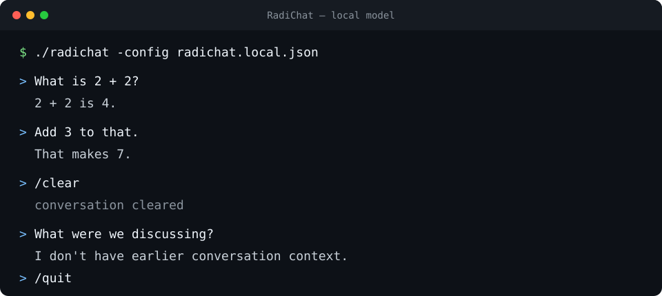
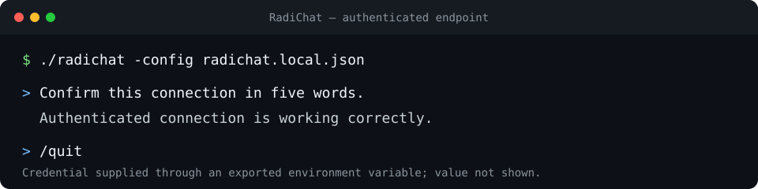

# RadiChat

**A small terminal client for local and remote OpenAI-compatible chat endpoints. Linux/amd64 is the only runtime-tested platform.**

RadiChat is for people who want streamed, multi-turn chat without an agent framework, database, browser UI, or background service. It is designed around local models and small context windows, while retaining an optional bearer-authenticated path for compatible remote endpoints.

The project exists to keep the client side boring: one Go binary, one JSON file, one in-memory conversation, and clear failures instead of discovery or fallback magic.



## Features

- Streamed OpenAI-compatible Chat Completions in a line-oriented terminal UI.
- Local unauthenticated endpoints work without credentials or environment setup.
- Optional bearer authentication through an environment variable named by the config file.
- Multi-turn context held only in process memory.
- Deterministic context-budget trimming for small model windows.
- `/clear` to reset conversation history and `/quit` to exit.
- Optional system-prompt file, `-input` for sequential file or FIFO turns, and opt-in JSONL results with `-output`.
- Strict HTTPS verification, redirect refusal, no retries, and no proxy discovery.
- One self-contained executable built with the Go standard library only.

## Who it is for

RadiChat fits developers and model users who already have an OpenAI-compatible endpoint and want a transparent terminal client. It works especially well for local inference servers, constrained models, shell workflows, and environments where storing chat history or credentials is undesirable.

It is intentionally not an agent runtime, automation harness, model server, or full-screen TUI.

## Install a prebuilt binary

The current release is [`v0.1.1`](https://github.com/radilabs/radichat/releases/tag/v0.1.1). It provides binaries for Linux and macOS on amd64 and arm64. Download the matching artifact and verify it against `SHA256SUMS` from the same release before running it. The macOS binaries are cross-compiled release artifacts. They are unsigned, not notarized, and not runtime-tested by this project. macOS runtime support is not claimed. The previous release, [`v0.1.0`](https://github.com/radilabs/radichat/releases/tag/v0.1.0), remains available unchanged.

## Install from source

You need Go 1.22 or newer.

```bash
git clone https://github.com/radilabs/radichat.git
cd radichat
go build -o radichat .
```

The build produces one executable in the repository root. Release `v0.1.1` binaries were built with Go 1.27.1 and native-smoke-tested on Linux/amd64. The module has no third-party dependencies.

Run the project checks with:

```bash
go test ./...
go vet ./...
go test -race ./...
```

## Local-model quick start

Start an OpenAI-compatible server, then copy the safe loopback example:

```bash
cp radichat.example.json radichat.local.json
```

Edit `radichat.local.json` so `endpoint` is the server's complete Chat Completions URL and `model` is a model it serves. The default example uses:

```json
{
  "endpoint": "http://127.0.0.1:8080/v1/chat/completions",
  "model": "local-model",
  "context_budget": 8192,
  "generation_reserve": 1024,
  "system_prompt": "You are a concise assistant."
}
```

Run RadiChat:

```bash
./radichat -config radichat.local.json
```

No token is needed. `radichat.local.json` and the default `radichat.json` are ignored by Git.

## Run in a container

The public image supports `linux/amd64` and `linux/arm64`. Pull the current versioned image:

```bash
docker pull ghcr.io/radilabs/radichat:v0.1.1
```

The same multi-platform `v0.1.1` image is also published on Docker Hub as [`docker.io/naorw/radichat:v0.1.1`](https://hub.docker.com/r/naorw/radichat). Both registries resolve to the same immutable image digest. No `latest` tag was published to Docker Hub.

```bash
docker pull docker.io/naorw/radichat:v0.1.1
```

The `v0.1.0` image predates the file-prompt and batch features (`system_prompt_file`, `-input`, and `-output`). Configurations that use them fail against it. `latest` on GHCR still points at `v0.1.0`, so use `v0.1.1` explicitly.

For a model server listening on the Linux host at `127.0.0.1`, mount the local config read-only and use host networking:

```bash
docker run --rm -it --network host \
  -v "$PWD/radichat.local.json:/config/radichat.json:ro" \
  ghcr.io/radilabs/radichat:v0.1.1
```

For an authenticated remote endpoint, forward the already-exported variable by name. Its value does not appear in the command:

```bash
docker run --rm -it \
  -v "$PWD/radichat.local.json:/config/radichat.json:ro" \
  -e RADICHAT_BEARER_TOKEN \
  ghcr.io/radilabs/radichat:v0.1.1
```

The image is configured to run as non-root (UID/GID `65532:65532`) and contains the static RadiChat binary plus the CA certificates needed for strict HTTPS verification. The image has not been executed in a container. See [Container image](docs/container.md) for image digests, networking details, and verification scope.

## Authenticated endpoint

The tracked [`radichat.remote.example.json`](radichat.remote.example.json) contains placeholders only:

```json
{
  "endpoint": "https://api.example.invalid/v1/chat/completions",
  "model": "remote-model",
  "context_budget": 8192,
  "generation_reserve": 1024,
  "system_prompt": "You are a concise assistant.",
  "bearer_token_env": "RADICHAT_BEARER_TOKEN"
}
```

Copy it to an ignored local file, replace the endpoint and model, and export the named variable in the same shell:

```bash
cp radichat.remote.example.json radichat.local.json
export RADICHAT_BEARER_TOKEN='<your-token>'
./radichat -config radichat.local.json
```

The JSON stores the environment-variable name, never the credential. If the variable is unset, empty, or unsuitable for an HTTP header, RadiChat exits before contacting the network. Avoid putting credentials directly in config files, command arguments, or shell history.



The capture uses a loopback mock endpoint and a dummy credential; no credential, private endpoint, hostname, model, username, or local path is shown.

## Configuration

RadiChat reads one strict JSON object. Unknown or duplicate fields fail at startup.

| Field | Required | Meaning |
| --- | --- | --- |
| `endpoint` | yes | Complete `http://` or `https://` Chat Completions URL. |
| `model` | yes | Model name sent unchanged to the endpoint. |
| `context_budget` | yes | Positive application working-budget units for request context. |
| `generation_reserve` | yes | Positive completion reserve and `max_tokens`; must be smaller than the context budget. |
| `system_prompt` | no | Fixed leading system message. Mutually exclusive with `system_prompt_file`. |
| `system_prompt_file` | no | UTF-8 file used as the system prompt. Relative paths resolve from the config file's directory. |
| `bearer_token_env` | no | Name of the environment variable containing the bearer token. |

See [Configuration](docs/configuration.md) for validation rules and [Context accounting](docs/context-accounting.md) for the deterministic byte-based budget policy.

## Terminal commands

| Command | Effect |
| --- | --- |
| `/clear` | Clear in-memory user/assistant history while retaining the configured system prompt. |
| `/quit` | Exit successfully. |
| Ctrl-C | Cancel and discard an in-flight turn, then exit 130. |
| SIGTERM | Cancel and discard an in-flight turn, then exit 143. |
| EOF | Exit after processing any final input line. |

Blank lines are ignored. Unknown slash commands are rejected locally and are not sent to the model. See [CLI behavior](docs/cli.md) for streams, errors, and exit codes.

## Supported protocol subset

RadiChat sends one `POST` to the configured URL with:

- `Content-Type: application/json` and `Accept: text/event-stream`;
- `model`, `messages`, `stream: true`, and `max_tokens` in the JSON body;
- `system`, `user`, and `assistant` text messages only;
- an optional `Authorization: Bearer …` header when configured.

It expects Server-Sent Events containing OpenAI-compatible `choices[].delta.content` strings followed by `data: [DONE]`. It supports normal text streaming, role-only chunks, UTF-8 text, CRLF or LF framing, and `stop` or `length` completion reasons.

RadiChat deliberately rejects redirects, non-streaming responses, malformed or unfinished streams, multiple choices, tool/function calls, and unsupported finish reasons. Requests are not retried. HTTPS uses system roots with TLS 1.2 or newer; there is no insecure mode or custom-CA option.

The exact behavior and limits are documented in [Protocol subset](docs/protocol.md).

## Context and privacy model

Conversation history lives only in memory and disappears when the process exits. RadiChat writes no transcript, session database, credential file, or log unless `-output` is set. That JSONL file records completed turns for the run and is not reloaded. When a request would exceed `context_budget`, it drops the oldest complete user/assistant pairs while retaining the system prompt and current user message. Earlier JSONL records stay in the output. A non-empty system prompt is checked against the same budget before the first request.

Bearer tokens live in process memory after startup. The authenticated path omits untrusted response bodies, redirect destinations, and underlying transport text from diagnostics, and filters exact credential echoes from streamed output. Process environments are not encrypted and may still be visible to the same user or system administrator.

## Limitations and non-goals

- Linux is the only platform the project runtime-tests. Other release artifacts are cross-compiled and carry no runtime support claim.
- Batch input is sequential: one request at a time, with no concurrency and no retries. JSONL results are per run and are not reloaded. See [Batch input and JSONL results](docs/batch.md).
- SIGINT and SIGTERM cannot interrupt a process that is blocked opening a FIFO for `-input`. Exit 130 or 143 occurs only after a writer opens the FIFO. Use a regular file when prompt signal exit is required.
- The client supports a narrow streaming Chat Completions subset, not every provider extension.
- Context accounting uses deterministic UTF-8 byte-based units, not a model tokenizer.
- There is no endpoint discovery, hidden fallback, automatic retry, or non-streaming fallback.
- There is no session persistence, database, compaction, or summarization.
- There are no tools, function execution, agents, RAG, embeddings, MCP, browser control, or shell execution.
- There is no OAuth flow, credential store, provider-specific login, TLS bypass, or custom CA handling.
- There is no GUI or full-screen TUI.

These boundaries are product choices for the current release state, not missing setup steps.

## Project status and release information

Phases 0–6 are accepted. Phase 6 (v0.1.1 file prompts, `-input`, and JSONL `-output`) is accepted on `main`, and it is published as release `v0.1.1`: [GitHub release](https://github.com/radilabs/radichat/releases/tag/v0.1.1), tag at commit `6645988e354076fede28070686b23667d0ff89ac`, and the GHCR image `ghcr.io/radilabs/radichat:v0.1.1` at `sha256:10e843853f975998159e6110aeb55c5b9e1ec5db8edfd2f9d1ad59a9fc112505`. The image has not been run in a container. `latest` was not moved and still resolves to `v0.1.0`.

Current release: [`v0.1.1`](https://github.com/radilabs/radichat/releases/tag/v0.1.1), file prompts, sequential `-input`, and JSONL `-output`. Previous release: [`v0.1.0`](https://github.com/radilabs/radichat/releases/tag/v0.1.0), the initial public source release for the accepted local-chat and endpoint-authentication feature set. The repository does not yet define a broader versioning policy.

High-level roadmap:

- Phase 0 — repository and product contracts: accepted.
- Phase 1 — unauthenticated local chat core: accepted.
- Phase 2 — optional bearer authentication: accepted.
- Phases 3–5 — Factory v1.2 migration, `radichat-mock` test tooling, and the adversarial protocol investigation: accepted.
- Phase 6 — v0.1.1 file prompts, `-input`, and JSONL `-output`: accepted and released as `v0.1.1`. The Kubernetes example uses the published image digest; it is documentation and an example only, and has not been run in a cluster.

## Documentation

- [Configuration](docs/configuration.md)
- [Protocol subset](docs/protocol.md)
- [Context accounting](docs/context-accounting.md)
- [CLI behavior](docs/cli.md)
- [Batch input and JSONL results](docs/batch.md)
- [Kubernetes Job example](docs/kubernetes.md)
- [Container image](docs/container.md)
- [Accepted Phase 2 handoff](docs/handoffs/phase-2.md)
- [Product direction](PROJECT.md)

## License

RadiChat is available under the [MIT License](LICENSE). Copyright © 2026 Radilabs by Forthscale.
